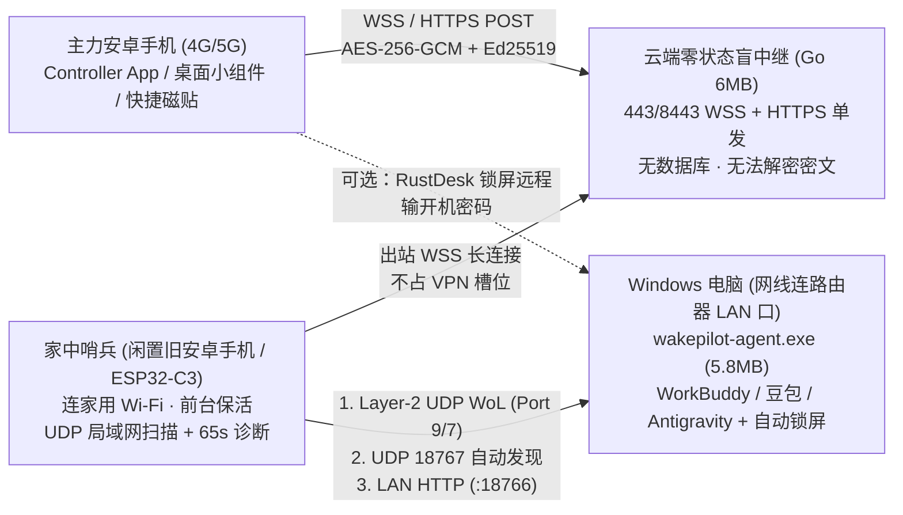

<div align="center">

# WakePilot

**Zero-VPN-Conflict, End-to-End Encrypted Cross-Platform Remote Wake-on-LAN & AI Desktop Orchestrator**

**零 VPN 冲突 · 端到端加密（E2EE）· 跨互联网远程开机与 AI 桌面客户端唤醒平台**

[](LICENSE)
[](server/)
[](android-app/)
[](windows-agent/)
[](esp32-sentinel/)

*唤醒家里的 Windows 电脑，自动拉起 WorkBuddy / 豆包 / Google Antigravity 并自动锁屏保护隐私——无需路由器管理员密码、无需公网家庭宽带、绝不抢占安卓手机 VPN 槽位。*

</div>

---

## 为什么做 WakePilot？

当你想在外出用 4G/5G 手机唤醒家里的 Windows 电脑让本地 AI 工作台（WorkBuddy、豆包桌面端、Google Antigravity 等）干活时，传统方案总有绕不开的坑：

| 对比维度 | 路由器端口转发 / DDNS | VPN 异地组网 + Termux | 硬件开机卡 / 智能插座 | **WakePilot** |
| :--- | :---: | :---: | :---: | :---: |
| 需要路由器管理员密码 | 需要 | 不需要 | 不需要 | **不需要** |
| 需要家庭宽带公网 IPv4 | 强依赖（CGNAT 失效） | 不需要 | 不需要 | **不需要** |
| 占用手机 VPN 槽位 | 否 | **是（顶掉代理/公司 VPN）** | 否 | **否（纯出站长连接）** |
| 云端零知识端到端加密 | 否 | 依赖账号/中继 | 闭源厂商云 | **HKDF + AES-256-GCM + Ed25519** |
| 免手抄 MAC / 故障诊断 | 否 | 手写配置 | 否 | **一键扫描 + 65 秒分级诊断** |
| 拉起 AI 后自动锁屏护隐私 | 否 | 否 | 否 | **原生 Win32 `LockWorkStation()`** |
| 额外硬件成本 | 0 元 | 0 元（闲置旧手机） | 30～150 元 | **0 元（闲置手机）或 15 元 ESP32** |

---

## 系统架构



---

## 核心特性

1. **云端零状态盲中继（[server/](server/)）**
   - 单文件 Go 静态二进制（`~6 MB`，内存上限 `< 64 MB`，无数据库），支持 `WSS/WS` 长连接与 `POST /api/v1/relay/{sid}` 无状态单发接口。
   - 仅依据不可逆哈希 `SHA-256("wakepilot-channel-v1:" || room_key)` 路由，**永远看不到主密钥、MAC 地址与业务明文**。
2. **字节级互通的 E2EE 协议（[docs/PROTOCOL.md](docs/PROTOCOL.md)）**
   - 二维码离线光学交换 256-bit `room_key` → `HKDF-SHA256` 双向密钥派生 → `AES-256-GCM` 认证加密 → `Ed25519 (RFC 8032)` 签名 → `±120s` 时间戳 + Nonce LRU 防重放。
   - Go、Android (Kotlin + BouncyCastle) 与 ESP32-C3 (C++ + mbedTLS) 三端完全互通。
3. **单一 APK 双角色合一（[android-app/](android-app/)）**
   - **家中哨兵（闲置备用机）**：原生 `Foreground Service` + `PARTIAL_WAKE_LOCK` + 防杀后台白名单一键跳转 + **一键局域网 UDP/ARP 扫描电脑（免手抄 MAC）** + 二维码配对 + OLED 纯黑床头时钟。
   - **随身遥控器（主力手机）**：摄像头扫码绑定 + 实时开机进度与 65 秒故障根因诊断 + **原生桌面小组件** + **锁屏下拉快捷磁贴** + 一键复制 ID 跳转 **RustDesk** 远程输入 Windows 开机密码与 **Antigravity** 远程控制台。
4. **原生 Win32 单文件桌面代理（[windows-agent/](windows-agent/)）**
   - 单文件 `wakepilot-agent.exe`（`~5.9 MB`，零 Python/.NET 依赖）。
   - `--check` 红绿灯自检 / `--fix` 一键关闭快速启动与开启网卡 WoL / 自动过滤 Hyper-V 与 WSL 虚拟网卡 / 白名单幂等拉起 WorkBuddy、豆包、Antigravity，并在 3 秒后调用原生 Win32 `LockWorkStation()` 自动锁屏。
5. **15 元硬件哨兵平滑演进（[esp32-sentinel/](esp32-sentinel/)）**
   - 内置同协议 ESP32-C3 PlatformIO 固件（功耗 `< 0.5 W`），插在路由器 USB 口即可无缝替换闲置旧手机，主力机 App 零改动。

---

## 3 分钟快速上线

### 1. 部署云端盲中继（任意 Linux VPS）
从 [Releases](../../releases) 下载 `wakepilot-relay-linux-amd64` 与 [`server-deploy/deploy_aliyun.sh`](server-deploy/deploy_aliyun.sh)，在云服务器放行入方向 TCP `8443`（或配证书走 `443`）后执行：
```bash
sudo bash deploy_aliyun.sh 8443
```
*(可选：如需通过同一台服务器自建私有 RustDesk 中继以在 Windows 锁屏界面远程输入开机密码，见 [`server-deploy/rustdesk-compose.yml`](server-deploy/rustdesk-compose.yml)。)*

### 2. 配置 Windows 电脑端
从 [Releases](../../releases) 下载 `wakepilot-agent.exe`，双击运行 [`windows-agent/一键安装_WakePilot_Windows.bat`](windows-agent/%E4%B8%80%E9%94%AE%E5%AE%89%E8%A3%85_WakePilot_Windows.bat)：
- 自动关闭 Windows 快速启动、开启有线网卡魔术包唤醒、放行防火墙并注册用户交互式登录自启任务（避开 Session 0 隔离）。
- 重启进一次主板 BIOS：关闭 `ErP/EuP`，开启 `Power On By PCI-E / Wake on LAN`。

### 3. 两台安卓手机安装同一个 APK
从 [Releases](../../releases) 下载安装 `WakePilot.apk`：
- **备用手机（连家用 Wi-Fi）**：选「设为家中哨兵」→ 点 **「扫描局域网电脑」** 自动识别电脑 → 填入中继地址 `http://<你的VPS_IP>:8443` → 开启常驻服务与防杀后台白名单。
- **主力手机（4G/5G）**：选「设为随身遥控器」→ 扫备用机屏幕上的配对二维码即可完成 E2EE 绑定；在手机桌面添加 **WakePilot 小组件**或在下拉控制中心添加 **「远程开机」磁贴**。

---

## 从源码构建

```bash
# 1. 运行 Go 端密码学、盲中继与 Windows 代理全部测试
go test -v ./...

# 2. 交叉编译 Linux 静态盲中继与 Windows 单文件代理
CGO_ENABLED=0 GOOS=linux GOARCH=amd64 go build -trimpath -ldflags="-s -w" -o dist/wakepilot-relay-linux-amd64 ./server
CGO_ENABLED=0 GOOS=windows GOARCH=amd64 go build -trimpath -ldflags="-s -w" -o dist/wakepilot-agent.exe ./windows-agent

# 3. 编译并测试 Android 双角色 APK（需要 JDK 21+ / Android SDK 34）
cd android-app
gradle testDebugUnitTest assembleDebug --no-daemon
```

---

## 目录结构

```text
wakepilot/
├── docs/PROTOCOL.md                  # WakePilot v1 端到端加密盲中继协议规范
├── shared/e2ee/                      # Go 端 HKDF-SHA256 + AES-256-GCM + Ed25519 核心库
├── server/                           # Go 云端零状态盲中继服务源码与端到端测试
├── server-deploy/                    # 云服务器一键部署脚本与 RustDesk Docker Compose
├── windows-agent/                    # Go + Win32 原生单文件代理与一键安装脚本
├── android-app/                      # Kotlin + Jetpack Compose 双角色原生 Android 工程
├── esp32-sentinel/                   # ESP32-C3 低功耗硬件哨兵同协议参考固件
└── .github/workflows/ci.yml          # GitHub Actions 自动测试、交叉编译与 Release 发布
```

## 安全与开源协议

- 安全模型与漏洞反馈请见 [SECURITY.md](SECURITY.md)。
- 本项目基于 [MIT License](LICENSE) 开源，欢迎提交 Issue 与 Pull Request！
